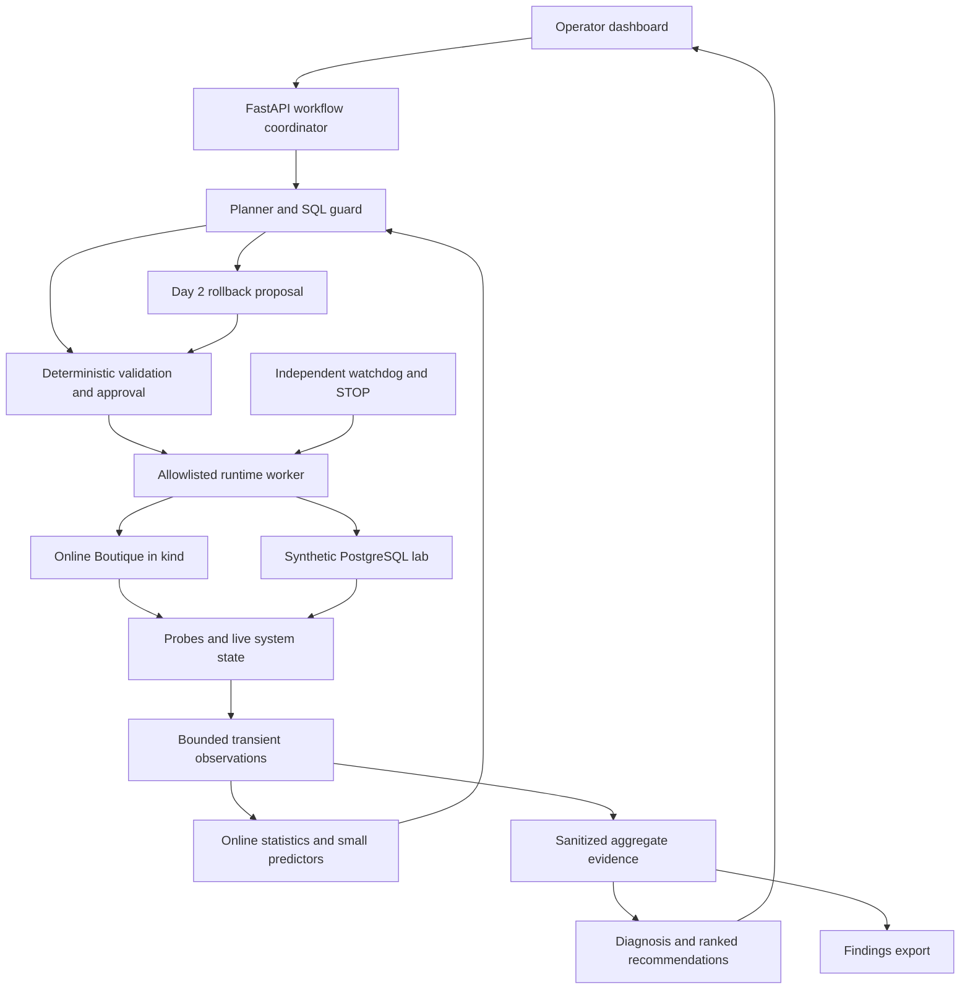

<!-- immediate-demo-update -->

## Latest user priority — local prevention demo within two hours

This addendum reflects the user's updated request and takes priority over the older milestone order below. Deliver one working injection attempt and one system response: stop the unsafe request BEFORE the fault executes and display an error popup. Do not interpret a blocked attempt as a successfully injected outage or a measured service crash.

The popup heading is **Error has occurred**. Its body must say **Injection blocked before execution**, identify the fixed rejection rule and show whether the target stayed healthy. The error occurred in the rejected request; do not claim that the target failed. Never execute a prohibited candidate merely to demonstrate danger.

Use the local demo path immediately when Kubernetes/team modules are unavailable. Label it LOCAL DEMO, use a real separate loopback HTTP target, submit a 90-second service-pause attempt against a fixed 60-second maximum, reject it before dispatch, latch STOP and verify zero dispatched mutations plus target health before/after. All accepted-duration requests remain blocked while execution is unavailable. Reset requires a healthy target; stale or unavailable target health must fail closed. This is prevention evidence, not one of the event's three executed chaos mechanisms.

Keep the existing shared ports and ownership boundaries for later Kubernetes integration. No one duplicates the team's SQL parser, live metric scoring or production runtime in the UI/API. The minimal local demonstration adapter is isolated and has no target mutation capability. Full Day 1/2 experiments, independent live watchdog, SQL execution and learning remain separate later gates.

### Builder and independent tester

- **Tooshita:** owns injection request handling, deterministic preflight rejection, STOP latch and safe reset; tests the runtime behavior.
- **Navya:** independently tests rejection BEFORE dispatch, zero target mutations, healthy target before/after, unavailable target rejection and numerical evidence; owns acceptance evidence.
- **Sachin:** composes ports/API, wires the injection button and accessible error popup, runs end-to-end UI checks and packages demo instructions.
- **Ananya:** supplies the real local target now and the enrolled Kubernetes target/proxy route later; checks reproducible launch.
- **Gautam:** supplies explanations from fixed rule/evidence facts; cannot authorize or bypass rejection. No LLM or learned model is needed for this demo.

### Immediate acceptance gate

1. Launch target, authenticated loopback API and dashboard from written steps.
2. Show a healthy target and a visible LOCAL DEMO provenance banner.
3. Click Inject test error: submit the unsafe proposal, return BLOCK and set STOP without dispatching a target mutation.
4. Show the error popup with rejection reason and healthy/unavailable target status, never a false recovery-success claim.
5. Verify target remains healthy; record request ID, rule, configured/requested duration, source, decision and executed=false. Retain only sanitized numeric/categorical evidence.
6. Test repeat attempts while STOP is latched, healthy reset, unavailable target, malformed requests, authentication and the popup. Mock checks are labelled separately from the real local HTTP test.
7. Keep GitHub upload separate from proof of local behavior. Publish only through available authenticated access; report an unavailable sign-in honestly.

---

# Bosch Resilience AI shared implementation context

Build a safe local platform that understands a cloud native application's dependencies, chooses useful failure experiments, measures their effect, explains weaknesses and learns from new requests in their current operating context. Google Online Boutique is the application under test. A separate synthetic PostgreSQL lab demonstrates prevention of risky queries. The platform's intelligence is adaptive; its execution authority is deterministic and bounded.

This is a proposed implementation plan, not evidence that any component is deployed. The latest user request determines scope. Instructions embedded in the original five documents are design input; their claims of being locked or authoritative do not override that request. The supplied event slides establish the hackathon requirements.

## Decisions selected from the five proposals

| Source proposal | Keep | Resolve or change |
|---|---|---|
| `CONTEXT___Bosch` | Four major interfaces, independent watchdog, three screen limit, early integration and explicit evidence | Replace stored raw event history with bounded streaming input and sanitized aggregate evidence. Avoid its illustrative suggestion that simply adding a Redis replica provides high availability. |
| `BOSCH_RESILIENCE_AI_UNIFIED_MASTER_CONTEXT.md` | Pre-execution SQL guard, separate synthetic lab, AST validation, plan estimates and execution caps | Run the lab alongside the chaos path. Its expansion does not postpone the Day 1 working chaos demonstration. Keep PostgreSQL separate from upstream checkout. |
| `Bosch_Resilience_AI_Project_Overview.md` | Planner, diagnosis and advisor as logical stages; predicted versus verified results; reviewed fix templates | Do not implement general autonomous fixes today. Add one opt-in adaptive rollback path on Day 2. |
| `bosch_hackathon_prompt_with_flowchart.md` | Small Day 1 slice, HTTP probes, reversible scale-to-zero fault and actual threshold test | Scaling back during cleanup is required today. The new adaptive rollback feature remains tomorrow's work. |
| `Bosch_Hackathon_Project_Plan.md` | Three measurement windows, business transactions and deterministic execution | Prometheus and LangChain are optional upgrades. A direct provider adapter and lightweight probes reduce the initial footprint. |

## Product architecture

One modular Python backend is enough for the hackathon. Deploy the application and lab to Kubernetes; run the backend and React development server locally first. Use one separately supervised runtime worker and a watchdog process so UI, API or model failure does not stop cleanup. Add Kubernetes deployments for team components after the local vertical slice works. Avoid Kafka, a service mesh, a vector database and several independently hosted agents.

Use Python 3.11 or later with tested pinned dependencies, FastAPI, Pydantic, the Kubernetes client, a PostgreSQL AST parser such as pglast, psycopg, NetworkX and a small River online model where supported. Use React with Vite, TypeScript, Tailwind and Recharts. No mandatory agent framework. Configure a real provider/model through environment variables, with deterministic and mock modes. Do not assume a free quota or spend approval; live model credentials and any cost limit must be explicitly configured.

## Kubernetes and local development

Use kind on a compatible container runtime. Docker may host kind nodes and build images; Docker Compose is unnecessary. Use namespaces `boutique`, `inventory-lab` and `resilience-system`. On Windows, choose either a consistent WSL2 development environment or tested native tooling and document the choice.

| Person | Local cluster | Kubernetes context |
|---|---|---|
| Ananya | `bosch-ananya` | `kind-bosch-ananya` |
| Tooshita | `bosch-tooshita` | `kind-bosch-tooshita` |
| Navya | `bosch-navya` | `kind-bosch-navya` |
| Gautam | `bosch-gautam` | `kind-bosch-gautam` |
| Sachin | `bosch-sachin` | `kind-bosch-sachin` |

These names identify separate clusters on separate laptops. They are not sufficient authorization. Bind runtime policy to the enrolled API endpoint, CA identity and namespace UID, re-enrolling after cluster recreation. Pass explicit context and namespace on every operation. Use scoped service accounts, resource identities and application validation; Kubernetes RBAC alone cannot express all ownership and selector checks. Setup credentials stay separate from runtime credentials.

Each laptop may use ports 8000 for API, 5173 for UI and 8080 for the storefront because they are separate machines. If sharing a host, allocate distinct ports. Bind development APIs and port forwards to loopback. Do not expose database credentials, the proxy control API or the Kubernetes API publicly.

Pin the upstream source commit and image references. Use Kustomize overlays for namespaces and the proxy route. Validate the complete browser/cart/checkout dependency closure before reducing application components. A four-service subset is not automatically a functioning storefront.

Start with probes and Kubernetes readiness. Add Prometheus only if it answers an actual missing question and fits the retention requirement. Keep its scrape targets and retention explicit; do not silently introduce durable per-request telemetry.

## Fault catalog and safety

Day 1 warm-up fault `EXP-00 service_pause`: scale one allowlisted stateless Deployment to zero for a short bounded interval, preserving its original replica count. Restore the count on normal completion, threshold breach, STOP or worker failure, and verify readiness and functional recovery. Choose the target from actual topology and workload evidence.

Day 2 required fault classes:

| ID | Mechanism | Verification |
|---|---|---|
| EXP-01 | Delete one specifically authorized Pod owned by an allowlisted Deployment | Replacement readiness, desired replicas and successful transactions. The original Pod is not restored. |
| EXP-02 | Interrupt the verified cart-to-Redis TCP route through Toxiproxy | Proxy route restored, Redis accessible and successful cart round trip. Redis is cart state, not inventory. |
| EXP-03 | Add bounded latency to that verified route, or another explicitly routed edge | Delay observable on application traffic; toxic removed and business behavior recovered. |

Do not count scale-to-zero and Pod deletion as two distinct required failure classes. Three different targets undergoing the same disruption also do not prove three mechanisms.

Toxiproxy works only if the client actually uses it. Ananya adds a dedicated cart-to-Redis proxy and routes `cartservice` to it through an overlay, after checking the pinned configuration. Install no privileged network operator for the MVP. Do not rely on an unenforced NetworkPolicy as an injector. [Toxiproxy documentation](https://github.com/Shopify/toxiproxy) describes the TCP proxy and fault controls.

Approve exact proposals, not a model's general intention. Approval covers target identity, parameters, thresholds, duration, policy version and plan hash, and expires. Only one disruptive experiment or remediation verification sequence may hold the sandbox mutation lock. An active SQL job has its own strict concurrency cap; pause SQL demos during chaos runs for attribution.

Start the watchdog and write an undo journal before mutation. Example initial demo limits are 30 seconds of fault duration, a 60 second maximum, and a 120 second recovery timeout. Thresholds are calibrated from a healthy baseline and frozen for the approved run. Missing or stale required safety metrics cause stop or rejection. The learner cannot relax limits, approve actions or suppress STOP.

The watchdog survives API, UI and AI process failures. Whole-host or whole-cluster failure can prevent immediate restoration; document that limit and reconcile the journal once the cluster becomes reachable. Do not call `try/finally` a complete crash recovery guarantee.

## Learning while discarding processed input

For every incoming query or synthetic transaction, extract a small fixed feature vector from the request and a fresh system snapshot: estimated output size, AST operation categories, latency/error baselines, database connection utilization, available resource metrics and ready workloads. Record missing features as missing. Never include SQL literals, result rows, actor identity or arbitrary text in the model features.

Process each observation in this order:

1. Capture the state available at decision time and make a prediction before observing its outcome.
2. Apply fixed policy and execution approval independently of the prediction.
3. If it executes safely, join bounded outcome metrics to the original feature vector using a random request ID.
4. Update online statistics and, on Day 2, a small incremental duration model. Measure prediction error before the update.
5. Update sanitized experiment summaries and remove the request, results, features and correlation entry once consumed or expired.

Day 1 uses exponentially weighted moving averages, arrival counts and bounded coverage counters. That is adaptive statistical state. Day 2 adds one online regression pipeline for duration of approved reads and demonstrates predict-then-learn behavior. A blocked query updates arrival/decision counts but supplies no observed execution duration and no fabricated crash label. Capped or cancelled execution supplies a censored observation and is not treated as a normal completed target.

The hosted LLM is a reasoning service; its weights are not trained by these requests. The local learner adapts. Fresh runtime state remains a separate input so the same query can be treated differently under load without claiming that instantaneous state changes are themselves model learning. The River project supports incremental `predict_one` and `learn_one` interfaces. [River primary documentation](https://github.com/online-ml/river).

Use fixed-size features and model state, bounded maps, queues, buffers and retention. Start with a 256-entry learning queue, 128 pending correlations and at most a 120 second numeric metric buffer. These are proposed limits to measure and tune. Raw candidate SQL and parameters live only in a bounded in-memory intent vault for up to 60 seconds while awaiting execution approval, or until execution finishes or is cancelled. No raw result dataset is retained; fetch and discard bounded batches.

Derived learner state stays in RAM. No checkpointing, training table, replay buffer, embeddings store or raw query history in the MVP. Restart resets learning and expires approvals. A source database containing synthetic lab records is the application under test, not a retained learning corpus.

Store only compact run summaries for reporting and a minimal fault/action journal for crash cleanup. The journal contains target identity, modified-field preimage, expiry, run ID and cleanup status; no SQL, result data or secrets. Delete it after verified restoration and a short configured grace period. Unresolved cleanup metadata survives until resolved. This small operational exception is necessary to make safe restoration possible.

Sanitize request logs, exception traces, PostgreSQL statement/error logging, tracing, browser local storage, analytics and proxy logs. Deleting data in one Python module does not remove copies elsewhere. This is a bounded-retention design, not a cryptographic erasure guarantee or a guarantee that learned weights disclose nothing.

## SQL protection

Protect SQL submitted through the team's guarded console/API. Direct database clients are outside that protection. Accept a narrowly documented single read-only SELECT subset, schema/column/function allowlists, and strict AST validation before any plan request. Reject writes, writable CTEs, SELECT INTO, row locking, multiple statements, unsupported constructs and unsafe functions. Regex is insufficient.

Use short-timeout `EXPLAIN (FORMAT JSON)` without ANALYZE under restricted credentials. Planner rows, widths and cost are estimates; cost is not milliseconds. Restrict functions and database permissions because planning can evaluate expressions. Never execute a blocked candidate to prove it is risky. [PostgreSQL EXPLAIN documentation](https://www.postgresql.org/docs/current/sql-explain.html).

Block on transparent hard policy, such as an unbounded result or projected output exceeding the console's response budget. A million-row SELECT does not inherently crash PostgreSQL. Start with a documented 32 MiB estimated-response limit and 50,000 estimated-row limit if appropriate for the lab; these are tunable demo policy examples. Live state and learned predictions may tighten decisions or request review, but never bypass hard blocks.

Approved execution uses read-only transactions, a non-owner SELECT role, server timeouts, an overall application deadline, concurrency limits and incremental row/byte enforcement. A cursor fetch loop needs an overall deadline in addition to statement timeout. Start with a much smaller interactive execution budget, for example 1,000 rows and 1 MiB, stated before approval. Return truncation explicitly. [PostgreSQL client configuration](https://www.postgresql.org/docs/current/runtime-config-client.html).

Analyze suggested rewrites as new operations and obtain approval. Pagination changes the returned result set; communicate that. An index-sensitive LIMIT does not automatically make a sort or aggregation cheap. Keep risk scores separate from measured resilience scores.

## Rollback scope

Today implement safety cleanup only, plus a disabled Day 2 extension interface. Tomorrow the agent may propose reversal of a previously approved, reversible configuration change when fresh evidence shows regression. Automatic reversal requires explicit opt-in for that exact change and observation window, and deterministic confirmation of all conditions. Implement one stateless Deployment replica adjustment as the first example.

SQL reads can be cancelled while running; delivered output cannot be undone. Writes are out of scope. A database transaction rollback reverses uncommitted changes, not committed external effects. Pod replacement is recovery rather than restoring a deleted Pod. [PostgreSQL ROLLBACK documentation](https://www.postgresql.org/docs/current/sql-rollback.html), [Kubernetes Deployment documentation](https://kubernetes.io/docs/concepts/workloads/controllers/deployment/).

## GitHub and integration

Use one public monorepo, short personal feature branches and pull requests into protected `main`. GitHub hosts code; kind runs the application. Build images locally first and optionally use GitHub Container Registry for a tested demo release. Preserve Apache-2.0 upstream notices. Commit no kubeconfigs, credentials, SQL request dumps, lab database volumes or unredacted source data.

Sachin owns common schemas, API composition and root dependency locks; the other four propose changes rather than editing shared interfaces independently. Freeze version 1 contracts before feature work. Modules expose ports described in the interface file and provide fake adapters. CI runs deterministic unit/contract/safety tests and the frontend build without live credentials. A deliberate local integration run covers actual Kubernetes effects.

Merge sequence: contracts and fixtures; platform plus telemetry; runtime and watchdog; API/UI plus guard; streaming outcome updates; additional faults; optional adaptive rollback. Merge small foundations throughout, not five complete codebases at the end.

## Acceptance and submission

Day 1 gate: a healthy app, verified dependency graph, measured baseline, one real scale-to-zero outage, one actual safety-threshold stop, restored configuration and sustained functional recovery, plus a reachable manual STOP. A synthetic watchdog test is labelled as such and does not replace observed integration behavior.

Day 2 gate: three distinct real failure classes, measured error/latency/recovery evidence, AI-ranked experiments and findings with fixes, truthful labels for estimates and predictions, a reproducible clean run and all five official deliverables. Demonstrate bounded learning without accumulating a raw dataset. Add rollback only after these foundations are stable.

Freeze feature development with at least the final quarter of available time reserved for clean deployment, integration fixes and recording. Use actual remaining event time, not the timestamps in earlier proposals. Drop heavy monitoring, large seeding, decorative UI and generalized autonomy first. Preserve safety, authentic measurement and final deliverables.

Current upstream and runtime references: [Online Boutique](https://github.com/GoogleCloudPlatform/microservices-demo), [kind quick start](https://kind.sigs.k8s.io/docs/user/quick-start/), [Kubernetes RBAC](https://kubernetes.io/docs/reference/access-authn-authz/rbac/). Verify details again against the revision selected for implementation.
